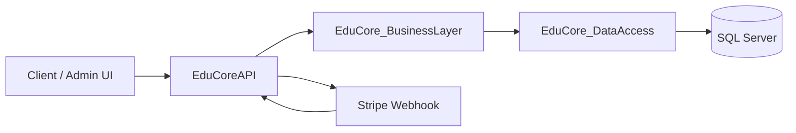

# EduCore System Guide — Overview

Navigation: [Architecture](01-architecture.md) · [Database](02-database.md) · [Business Logic](03-business-logic.md) · [Workflows](04-workflows.md) · [API Reference](05-api-reference.md) · [Security](06-security.md) · [Testing & Deployment](07-testing-and-deployment.md) · [Glossary](08-glossary.md)

## What EduCore is

EduCore is a backend-only learning-commerce platform. It sells educational content (courses and standalone lessons) and bundles of courses, processes payments, creates enrollments, tracks lesson progress, and issues certificates.

## Problems it solves

- Monetizing educational content through a product/order/payment pipeline.
- Granting and revoking access based on purchases and enrollment expiry.
- Tracking learner progress and issuing certificates.
- Managing course/lesson/bundle publication and instructor ownership.

## Primary users and actors

- **Student**: browses published products, purchases, accesses enrolled content, tracks progress.
- **Instructor**: creates/owns courses, lessons, bundles; manages publication.
- **Admin / SuperAdmin**: manages users, products, orders, payments, discounts, certificates.
- **Stripe**: external payment gateway; source of truth for "paid".

## Main capabilities

- User registration, authentication, JWT refresh.
- Product catalog (courses, lessons, bundles) with publication visibility.
- Orders and order items with state machine.
- Discount codes with usage limits.
- Payments with idempotency and Stripe webhook completion.
- Enrollments and bundle-based access.
- Lesson progress upsert.
- Certificate issuance and retrieval.
- Audit and system logs.

## Core business concepts

See [Glossary](08-glossary.md). Key chain: `Product → Order → Payment → Enrollment → Course Access`.

## Major modules

- `EduCoreAPI` — HTTP controllers, authorization, middleware.
- `EduCore_BusinessLayer` — domain logic (`clsCheckoutService`, `clsPayment`, `clsEnrollment`, etc.).
- `EduCore_DataAccess` — ADO.NET data access and stored procedures.
- `Common` — DTOs, enums, exceptions, view models.
- `EduCore.IntegrationTests` — integration tests against isolated SQL Server DB.

## System boundaries

- Backend REST API only (no frontend in this repo).
- SQL Server is the system of record.
- Stripe is the payment source of truth.

## Technology stack

- .NET 10, ASP.NET Core.
- Microsoft.Data.SqlClient (raw ADO.NET, no ORM).
- SQL Server stored procedures for critical mutations.
- JWT (HS256) auth, BCrypt passwords.
- QuestPDF for certificates.
- xUnit integration tests.

## High-level architecture



## Recommended reading order

1. This overview.
2. [Architecture](01-architecture.md)
3. [Database](02-database.md)
4. [Business Logic](03-business-logic.md)
5. [Workflows](04-workflows.md)
6. [API Reference](05-api-reference.md)
7. [Security](06-security.md)
8. [Testing & Deployment](07-testing-and-deployment.md)
9. [Glossary](08-glossary.md)
```