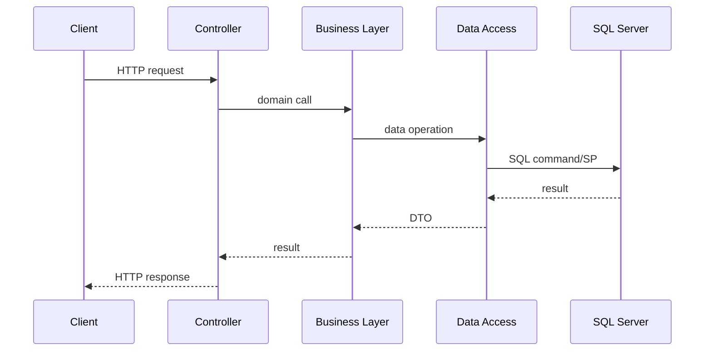
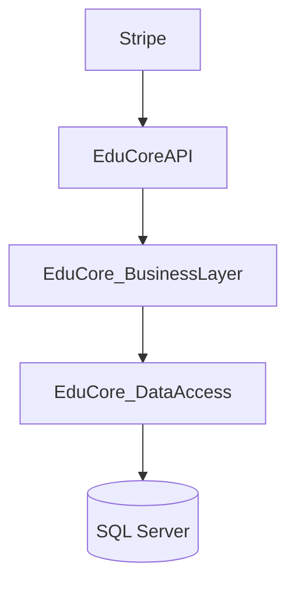
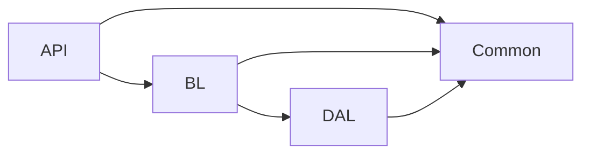

# Application Architecture

Navigation: [Overview](00-overview.md) · [Database](02-database.md) · [Business Logic](03-business-logic.md) · [Workflows](04-workflows.md) · [API](05-api-reference.md) · [Security](06-security.md) · [Testing](07-testing-and-deployment.md) · [Glossary](08-glossary.md)

## Solution structure

- `Common/Common.csproj` — shared DTOs, enums, exceptions, view models.
- `EduCoreAPI/EduCoreAPI.csproj` — ASP.NET Core host, controllers, auth, middleware.
- `EduCore_BusinessLayer/EduCore_BusinessLayer.csproj` — domain classes and services.
- `EduCore_DataAccess/EduCore_DataAccess.csproj` — ADO.NET data access.
- `EduCore.IntegrationTests/EduCore.IntegrationTests.csproj` — integration tests.
- `EduCore.slnx` — solution file.
- `EduCore.sql` — schema + stored procedures.

## Layers

- **API layer**: controllers receive HTTP requests, validate input, invoke business layer, return results. Hosts authorization handlers and middleware.
- **Business layer**: domain rules, transactions orchestration (`clsCheckoutService`), entities (`clsPayment`, `clsOrder`, `clsEnrollment`).
- **Data access layer**: parameterized ADO.NET commands and stored procedure calls.
- **Database**: SQL Server schema and stored procedures.

There is no separate "services" layer; business classes are static/instance domain classes.

## Controller → business → data flow

Controllers call business static methods (e.g., `clsOrder.CreateOrder`) which call data access (`clsOrderData`) and may execute stored procedures (`SP_CreateNewPayment`).

## Stored procedures

Critical mutations use stored procedures for atomicity and locking:
- `SP_AddNewItemToOrder`, `SP_RemoveItemFromOrder`, `SP_CreateNewPayment`, `SP_CreateEnrollmentsFromPaidOrder`.

## Request lifecycle



## Authentication/authorization

JWT bearer tokens; role-based and resource-based authorization handlers. See [Security](06-security.md).

## External integrations

- Stripe: webhook endpoint `api/webhooks/stripe`; signature verification in `clsStripeGateway`; completion via `clsCheckoutService.CompletePaymentAsync`.

## Async/background

No background workers; webhook-driven completion. Transactions via `clsGeneralData.ExecuteTransaction`.

## Component diagram



## Dependency diagram


```