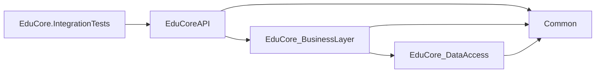
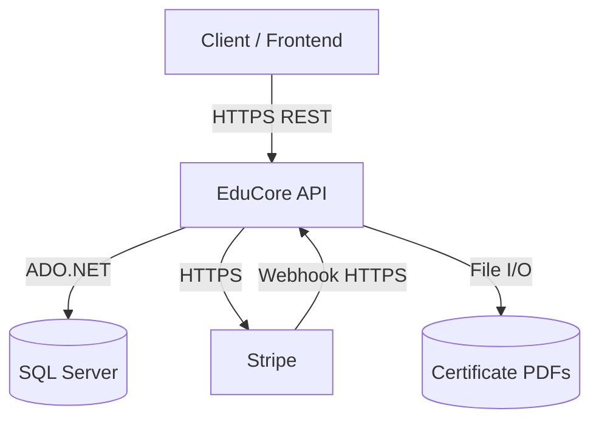
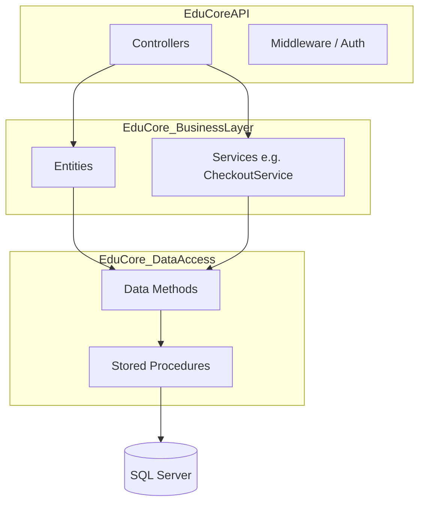
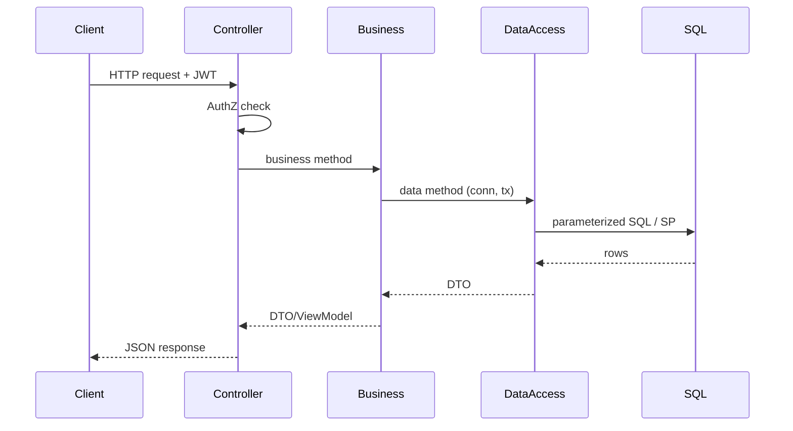

# EduCore — Architecture

## 1. Style

EduCore uses a pragmatic three-layer architecture:

```
EduCoreAPI  (controllers, middleware, auth)
   |
EduCore_BusinessLayer  (rules, orchestration)
   |
EduCore_DataAccess  (ADO.NET, stored procedures)
   |
SQL Server
```

`Common` holds shared contracts (DTOs, enums, exceptions, ViewModels) and is
referenced by all layers. There is **no** Services layer, no Repository
abstraction, and no ORM.

## 2. Projects

| Project | Responsibility |
|---|---|
| `Common` | DTOs (`DtoPayment`, `DtoOrder`, ...), enums (`enPaymentStatus`, `enOrderStatus`, `enProductType`), exceptions (`ValidationException`, `ConflictException`, `NotFoundException`, `ForbiddenException`), ViewModels, utilities. |
| `EduCore_DataAccess` | SQL connection/transaction helpers, query methods, stored procedure invocation. |
| `EduCore_BusinessLayer` | Domain entities (`clsPayment`, `clsOrder`, `clsCourse`, ...), business rules, orchestration, audit logging. |
| `EduCoreAPI` | ASP.NET Core host, controllers, authorization handlers, middleware, Swagger. |
| `EduCore.IntegrationTests` | xUnit tests running against an isolated `EduCoreTests` database. |

## 3. Dependencies

Project references are declared in each `.csproj` and flow strictly one way —
from the dependent project to its dependency:

| Project | Project references (`.csproj`) |
|---|---|
| `EduCoreAPI` | `EduCore_BusinessLayer`, `Common` |
| `EduCore_BusinessLayer` | `EduCore_DataAccess`, `Common` |
| `EduCore_DataAccess` | `Common` |
| `Common` | *(none)* |
| `EduCore.IntegrationTests` | `EduCoreAPI` (transitively reaches the layers above) |



**Layer communication rule:** communication is strictly one-directional —
`EduCoreAPI → EduCore_BusinessLayer → EduCore_DataAccess`. Controllers call
business classes only; the API must never reference, instantiate, or call
`EduCore_DataAccess` types directly, and every database operation reachable
from the API is exposed through the Business Layer. `EduCore_DataAccess` never
depends on the API or Business Layer, and `Common` carries shared types only —
it is not a channel for bypassing layer boundaries.

## 4. Layer Responsibilities

### Controllers (`EduCoreAPI/Controllers`)

- Parse HTTP requests and route parameters.
- Enforce authentication/authorization via attributes and `IAuthorizationService`.
- Call business-layer methods.
- Never reference, instantiate, or call `EduCore_DataAccess` types — every
  database operation is exposed to the API through the Business Layer.
- Map business exceptions to HTTP status codes via middleware.
- Return DTOs/ViewModels as JSON.

Controllers do **not** contain business rules or SQL.

### Business Layer

- Validate business preconditions.
- Orchestrate multi-step operations (e.g. `clsCheckoutService.CompletePaymentAsync`).
- Enforce ownership and role rules.
- Invoke data access with connections/transactions.
- Write audit entries.
- The only layer permitted to call `EduCore_DataAccess`.

### Data Access

- Open `SqlConnection`s.
- Execute parameterized SQL or stored procedures.
- Map `SqlDataReader` rows to DTOs/ViewModels.
- Provide transactional helpers (`LockOrderAsync`, `LockDiscountAsync`).
- Never depends on or communicates with `EduCoreAPI` or `EduCore_BusinessLayer`.

## 5. DTO / ViewModel Flow

```
HTTP JSON  <->  Controller  <->  Business (DTO/ViewModel)  <->  DataAccess (DTO)  <->  SQL Server
```

- Request bodies bind to DTOs/ViewModels in controllers.
- Business methods accept/return DTOs (`DtoPayment`, `DtoOrder`, ...).
- Data access returns DTOs/ViewModels populated from readers.
- No domain entity is serialized directly; controllers return DTOs/ViewModels.

## 6. ADO.NET Connection and Transaction Management

- `clsDataAccessSettings.ConnectionString` reads `DB_CONNECTION` env var
  (falls back to `Server=.;...`).
- Each data-access method that needs its own connection creates a
  `new SqlConnection(...)` and disposes it.
- Multi-statement transactions use `clsGeneralData.ExecuteTransaction`:

```csharp
public static async Task<T> ExecuteTransaction<T>(
    Func<SqlConnection, SqlTransaction, Task<T>> work)
{
    using (SqlConnection conn = new SqlConnection(...))
    {
        await conn.OpenAsync();
        using (SqlTransaction tx = (SqlTransaction)await conn.BeginTransactionAsync())
        {
            try { T result = await work(conn, tx); await tx.CommitAsync(); return result; }
            catch { await tx.RollbackAsync(); throw; }
        }
    }
}
```

- Stored procedures participating in a transaction receive `conn` and `tx`
  and use `new SqlCommand(sql, conn, tx)`.
- `SET XACT_ABORT ON` is used inside critical stored procedures so a
  runtime error rolls back the transaction.

## 7. Stored Procedure Invocation

Data access calls stored procedures via `CommandType.StoredProcedure` with
explicitly typed parameters, e.g. `SP_CreateNewPayment`, `SP_AddNewItemToOrder`,
`SP_RemoveItemFromOrder`, `SP_CreateEnrollmentsFromPaidOrder`,
`SP_IssueCertificate`. Critical paths (order mutation, payment creation,
enrollment creation, certificate issuance) are stored procedures to keep
locking and state transitions close to the data.

## 8. Locking Helpers

- `clsOrderData.LockOrderAsync(orderId, conn, tx)` — `SELECT ... FROM Orders
  WITH (UPDLOCK, ROWLOCK) WHERE Id = @Id`.
- `clsDiscountCodesData.LockDiscountAsync(id, conn, tx)` — `SELECT ... FROM
  DiscountCodes WITH (UPDLOCK, HOLDLOCK, ROWLOCK) WHERE Id = @Id`.

These establish a consistent lock-acquisition order across operations.

## 9. JWT and Authorization

- `Program.cs` configures JWT Bearer authentication with issuer/audience/
  signing key from configuration.
- Role claims drive `[Authorize(Roles = "...")]`.
- Resource ownership is enforced inside controllers via
  `IAuthorizationService.AuthorizeAsync(user, resourceId, "OwnerOrAdmin")`
  (and similar policies).
- `IsUserEnrolledOrAdminHandler` grants access to enrolled users or admins.

## 10. Stripe Webhook Entry

- Route: `POST /api/webhooks/stripe` (anonymous).
- `StripeWebhookController` reads the raw body, verifies the `Stripe-Signature`
  HMAC using the webhook secret, parses the event, and dispatches:
  - `payment_intent.succeeded` -> find payment by transaction id / metadata,
    call `clsCheckoutService.CompletePaymentAsync`.
  - `payment_intent.payment_failed` -> mark payment failed.
- Stripe never touches the database; all DB work goes through the application.

## 11. Certificate Generation

- `clsProgress.IssueCertificate` checks eligibility (enrollment + 100%
  completion), calls `SP_IssueCertificate` (idempotent), then generates a PDF
  via QuestPDF into `CERTIFICATES_STORAGE_PATH` if missing.
- QR code embedded in the PDF points at the verification endpoint.
- Public verification: `GET /api/certificates/{code}`.

## 12. Exception Mapping

Business exceptions map to HTTP responses (via middleware):

| Exception | HTTP |
|---|---|
| `ValidationException` | 400 |
| `NotFoundException` | 404 |
| `ConflictException` | 409 |
| `ForbiddenException` | 403 |
| `UnauthorizedAccessException` | 401 |

Unhandled exceptions become 500 with a generic message; details go to logs.

## 13. System Context Diagram



## 14. Component Architecture



## 15. Representative Request Sequence



## 16. Payment Completion Sequence

```mermaid
sequenceDiagram
  participant Stripe
  participant Webhook as StripeWebhookController
  participant Checkout as clsCheckoutService
  participant Payment as clsPayment
  participant SQL
  Stripe->>Webhook: POST /api/webhooks/stripe
  Webhook->>Webhook: verify HMAC
  Webhook->>Checkout: CompletePaymentAsync(userId, payment, txId)
  Checkout->>SQL: BEGIN TX; lock Order
  Checkout->>SQL: lock Discount (if any)
  Checkout->>Payment: MarkAsSucceeded (conditional UPDATE)
  Payment->>SQL: UPDATE Payments SET Succeeded WHERE Pending
  Checkout->>SQL: IncrementUsage (discount)
  Checkout->>SQL: SP_CreateEnrollmentsFromPaidOrder
  Checkout->>SQL: UPDATE Orders SET Completed
  Checkout->>SQL: expire sibling pending payments
  Checkout->>SQL: COMMIT
  Webhook-->>Stripe: 200 OK
```