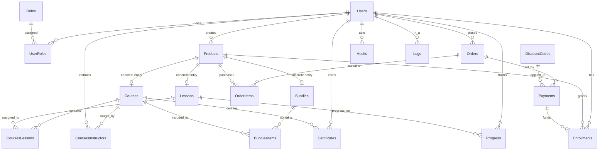

# EduCore — Database Reference

Database: SQL Server. Schema script: `EduCore.sql` (idempotent). Test DB:
`EduCoreTests` (isolated, created by the test fixture).

## 1. Conventions

- Primary keys are `INT IDENTITY` unless noted.
- Foreign keys are enforced.
- Soft deletion: `Courses.IsDeleted`, `Lessons.IsDeleted` (+ `DeletedAt`, `DeletedById`).
- Publication: `Products.IsPublished` (no soft-delete column on `Products`).
- `Users.IsActive` controls login eligibility; distinct from deletion (there is
  no user deletion column; deactivation sets `IsActive = 0`).
- `ExpireAt` is a `DATE`: validity runs through the end of that day (UTC).

## 2. Core ER Diagram

## 3. Tables

### Users
Purpose: account identity.

| Column | Type | Null | Notes |
|---|---|---|---|
| Id | INT PK IDENTITY | NOT NULL | |
| Name | NVARCHAR(150) | NOT NULL | |
| BirthDate | DATE | NOT NULL | |
| Email | NVARCHAR(254) | NOT NULL UNIQUE | |
| PasswordHash | NVARCHAR(255) | NOT NULL | BCrypt. |
| RefreshTokenHash | NVARCHAR(255) | NULL | BCrypt hash of refresh token. |
| RefreshTokenExpiresAt | DATETIME2 | NULL | |
| RefreshTokenRevokedAt | DATETIME2 | NULL | |
| IsActive | BIT | NOT NULL DEFAULT 1 | login eligibility. |
| CreatedAt | DATETIME2 | NOT NULL DEFAULT UTC | |

### Roles
| Column | Type | Null | Notes |
|---|---|---|---|
| RoleId | TINYINT PK IDENTITY | NOT NULL | |
| Name | NVARCHAR(50) | NOT NULL UNIQUE | Admin, Instructor, Student, SuperAdmin. |

### UserRoles
Junction user↔role. PK `(UserId, RoleId)`. FKs to Users, Roles.

### Products
The sellable unit. No soft-delete column.

| Column | Type | Null | Notes |
|---|---|---|---|
| Id | INT PK IDENTITY | NOT NULL | |
| ProductType | TINYINT | NULL | 1=Lesson, 2=Course, 3=Bundle (per enum). |
| Name | NVARCHAR(120) | NOT NULL | |
| CreatedAt | DATETIME2 | NULL DEFAULT UTC | |
| UpdatedAt | DATETIME2 | NULL | |
| BasePrice | DECIMAL(9,2) | NOT NULL | |
| CreatedByUser | INT FK Users | NOT NULL | |
| ThumbnailUrl | NVARCHAR(500) | NULL | |
| Summary | NVARCHAR(300) | NULL | |
| IsPublished | BIT | NULL DEFAULT 0 | public visibility. |

### Courses
| Column | Type | Null | Notes |
|---|---|---|---|
| Id | INT PK IDENTITY | NOT NULL | |
| ProductId | INT FK Products | NOT NULL | |
| CoverImageUrl | NVARCHAR(350) | NULL | |
| IsDeleted | BIT | NULL DEFAULT 0 | soft delete. |
| DeletedAt | DATE | NULL | |
| DeletedById | INT FK Users | NULL | |

### CoursesInstructors
Junction course↔instructor. PK `(CourseId, InstructorId)`.

### Lessons
| Column | Type | Null | Notes |
|---|---|---|---|
| Id | INT PK IDENTITY | NOT NULL | |
| ProductId | INT FK Products | NOT NULL | |
| Title | NVARCHAR(150) | NOT NULL | |
| VideoUrl | NVARCHAR(500) | NULL | |
| BodyText | NVARCHAR(MAX) | NULL | |
| IsDeleted | BIT | NULL DEFAULT 0 | soft delete. |
| DeletedAt | DATE | NULL | |
| DeletedById | INT FK Users | NULL | |
| InstructorId | INT FK Users | NULL | |
| CourseId | INT FK Courses | NULL | NULL = standalone lesson. |

### Bundles
| Column | Type | Null | Notes |
|---|---|---|---|
| Id | SMALLINT PK IDENTITY | NOT NULL | |
| ProductId | INT FK Products | NOT NULL | |

### CoursesLessons
Junction course↔lesson. PK `(CourseId, LessonId)`. FKs to Courses, Lessons.

### BundlesItems
Junction bundle↔course. **Composite PK `(BundleId, CourseId)`**. FKs to Bundles, Courses.

### Progress
| Column | Type | Null | Notes |
|---|---|---|---|
| UserId | INT FK Users | NOT NULL | part of PK |
| LessonId | INT FK Lessons | NOT NULL | part of PK |
| CompletedDate | DATE | NULL DEFAULT UTC | set on completion; preserved on incomplete. |
| IsComplete | BIT | NULL | |

PK `(UserId, LessonId)`.

### DiscountCodes
| Column | Type | Null | Notes |
|---|---|---|---|
| Id | SMALLINT PK IDENTITY | NOT NULL | |
| DiscountCode | NVARCHAR(200) | NOT NULL | |
| DiscountRate | DECIMAL(5,2) | NULL | percentage 0–100. |
| CreatedById | INT FK Users | NOT NULL | |
| ExpireAt | DATE | NULL | valid through end of day. |
| AllowedUseNumber | SMALLINT | NULL | 0/NULL = unlimited. |
| TotalUserNumber | SMALLINT | NULL | incremented when a payment **succeeds**. |

### Orders
| Column | Type | Null | Notes |
|---|---|---|---|
| Id | INT PK IDENTITY | NOT NULL | |
| UserId | INT FK Users | NOT NULL | |
| TotalPrice | DECIMAL(9,2) | NULL | sum of item price snapshots. |
| Status | VARCHAR(50) | NULL | Empty/Pending/Completed/Cancelled. |
| CreatedAt | DATETIME2 | NULL DEFAULT UTC | |

Unique filtered index `UX_Orders_User_Pending` on `UserId WHERE Status='Pending'`
(one pending order per user).

### OrderItems
| Column | Type | Null | Notes |
|---|---|---|---|
| Id | INT PK IDENTITY | NOT NULL | |
| OrderId | INT FK Orders | NOT NULL | |
| ProductId | INT FK Products | NOT NULL | |
| PriceAtPurchase | DECIMAL(9,2) | NULL | price snapshot. |

Unique `(OrderId, ProductId)`.

### Payments
| Column | Type | Null | Notes |
|---|---|---|---|
| Id | INT PK IDENTITY | NOT NULL | |
| OrderId | INT FK Orders | NOT NULL | |
| CreatedAt | DATETIME2 | NOT NULL DEFAULT UTC | |
| PaidAt | DATETIME2 | NULL | |
| Price | DECIMAL(18,2) | NOT NULL | order total at payment time. |
| DiscountId | SMALLINT FK DiscountCodes | NULL | |
| DiscountPrice | DECIMAL(18,2) | NULL | computed discount. |
| PaymentMethod | NVARCHAR(50) | NOT NULL | |
| Status | VARCHAR(50) | NOT NULL DEFAULT Pending | Pending/Succeeded/Failed/Expired/Cancelled. |
| TransactionId | NVARCHAR(200) | NULL | Stripe payment intent id. |
| IdempotencyKey | VARCHAR(255) | NOT NULL UNIQUE | |
| FinalPrice | DECIMAL (computed) | PERSISTED | Price - ISNULL(DiscountPrice,0). |

Indexes: `UX_Payments_IdempotencyKey` (unique), `UX_Payments_TransactionId`
(unique filtered where not null), `IX_Payments_OrderId`.

### Enrollments
| Column | Type | Null | Notes |
|---|---|---|---|
| Id | INT PK IDENTITY | NOT NULL | |
| UserId | INT FK Users | NOT NULL | |
| ProductId | INT FK Products | NOT NULL | |
| EnrolledAt | DATETIME2 | NULL DEFAULT UTC | |
| ExpireAt | DATE | NULL | NULL = non-expiring. |
| PaymentId | INT FK Payments | NOT NULL | |

Unique `(UserId, ProductId)`.

### Certificates
| Column | Type | Null | Notes |
|---|---|---|---|
| Id | INT PK IDENTITY | NOT NULL | |
| CertificateCode | NVARCHAR(64) | NOT NULL UNIQUE | |
| UserId | INT FK Users | NOT NULL | |
| CourseId | INT FK Courses | NOT NULL | |
| IssuedAt | DATETIME2 | NOT NULL DEFAULT UTC | |

Unique `(UserId, CourseId)`.

### Audits
Action trail. Columns: Id, UserId (FK Users), ActionType, EntityType, EntityId,
Description, DoneAt, IpAddress, UserAgent.

### Logs
Error/operational log. Columns: Id, LogType, Message, Source, StackTrace,
IpAddress, UserAgent, RequestPath, CreatedAt.

## 4. Views

- `vwLessonsWithOutCourses` — standalone, non-deleted lessons joined with
  product + instructor.
- `vwLessonsWithCourses` — course-attached, non-deleted lessons joined with
  product + instructor.

## 5. Stored Procedures

| Procedure | Purpose |
|---|---|
| `SP_AddNewItemToOrder` | Lock order, validate state, prevent pending payment, insert item, recompute total. |
| `SP_RemoveItemFromOrder` | Lock order, validate state, prevent pending payment, delete item, recompute total. |
| `SP_CreateNewPayment` | Lock order, idempotency, pending-payment guard, discount validation/reservation, insert pending payment. |
| `SP_CreateEnrollmentsFromPaidOrder` | Renew expired enrollments and insert new ones for order items. |
| `SP_IssueCertificate` | Eligibility checks + idempotent certificate issuance. |

## 6. Relationships: Products ↔ Content

A `Product` is the sellable abstraction. Concrete entities reference it:

- `Courses.ProductId` -> Products.Id
- `Lessons.ProductId` -> Products.Id
- `Bundles.ProductId` -> Products.Id

Order items and enrollments reference `Products.Id`, **not** courses/lessons
directly. This keeps pricing, publication, and enrollment uniform across all
product types (a bundle enrollment is an enrollment on the bundle's product).

## 7. Why Order Items Refer to Products

Pricing and publication live on `Products`. An order line must snapshot
`PriceAtPurchase` from the product's `BasePrice` and check `IsPublished`.
Referencing `Products` (rather than Course/Lesson) lets one order contain
lessons, courses, and bundles uniformly and keeps the order model independent
of content structure.<|end|><|start|>write to=assistant<|channel|>analysis<|message|>Wrote file successfully: docs/system-guide/02-database.md