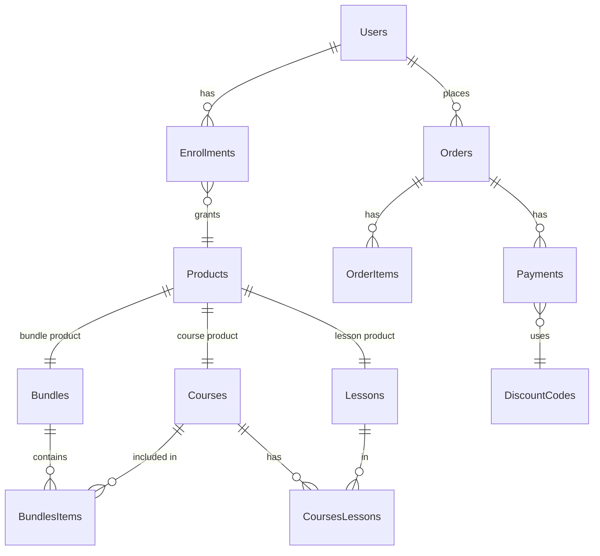

# Database Design and Relationships

Navigation: [Overview](00-overview.md) · [Architecture](01-architecture.md) · [Business Logic](03-business-logic.md) · [Workflows](04-workflows.md) · [API](05-api-reference.md) · [Security](06-security.md) · [Testing](07-testing-and-deployment.md) · [Glossary](08-glossary.md)

## Core tables

- **Users**: Id PK, Name, Email (unique), PasswordHash, IsActive, CreatedAt, etc.
- **Roles / UserRoles**: role assignment.
- **Products**: Id PK, ProductType (tinyint), Name, BasePrice, IsPublished, CreatedByUser FK, etc. No soft-delete column.
- **Courses**: Id PK, ProductId FK→Products, CoverImageUrl, IsDeleted, DeletedAt, DeletedById.
- **Lessons**: Id PK, ProductId FK→Products, Title, VideoUrl NVARCHAR(500), BodyText, IsDeleted, DeletedAt, DeletedById, InstructorId, CourseId (nullable).
- **CoursesLessons**: CourseId, LessonId PK (junction).
- **Bundles**: Id PK (smallint), ProductId FK→Products.
- **BundlesItems**: BundleId, CourseId (junction).
- **Orders**: Id PK, UserId FK, Status, TotalPrice, etc.
- **OrderItems**: OrderId, ProductId, PriceAtPurchase.
- **Payments**: Id PK, OrderId FK, Price, DiscountId FK, DiscountPrice, PaymentMethod, Status, TransactionId, IdempotencyKey (unique), PaidAt.
- **DiscountCodes**: Id PK, DiscountCode, DiscountRate, AllowedUseNumber, ExpireAt, TotalUserNumber.
- **Enrollments**: Id PK, UserId FK, ProductId FK, EnrolledAt, ExpireAt, PaymentId.
- **Progress**: UserId, LessonId PK, CompletedDate, IsComplete.
- **Certificates**: Id PK, UserId, CourseId/ProductId, CertificateCode, etc.
- **Audits / Logs**: audit trail.

## Key relationships

- Product 1—1 Course/Bundle/Lesson (via ProductId).
- Bundle 1—M BundleItems —M Courses.
- Course 1—M CoursesLessons —M Lessons.
- Order 1—M OrderItems (products).
- Order 1—M Payments.
- Payment M—1 DiscountCode.
- Enrollment M—1 User, Product.
- Progress M—1 User, Lesson.

## ER diagram (core)



## Soft deletion / activation / publication

- Users: `IsActive` (deactivation, not deletion).
- Courses/Lessons: `IsDeleted` (+ DeletedAt, DeletedById).
- Products: no soft-delete; visibility via `IsPublished`.
- Enrollments: expiry via `ExpireAt` (DATE, valid through end of day UTC).

## Indexes/constraints

- PKs as above; unique idempotency key on Payments; PK on Progress (UserId, LessonId); PK on CoursesLessons; PK on BundlesItems? (none specified, but junction).
```