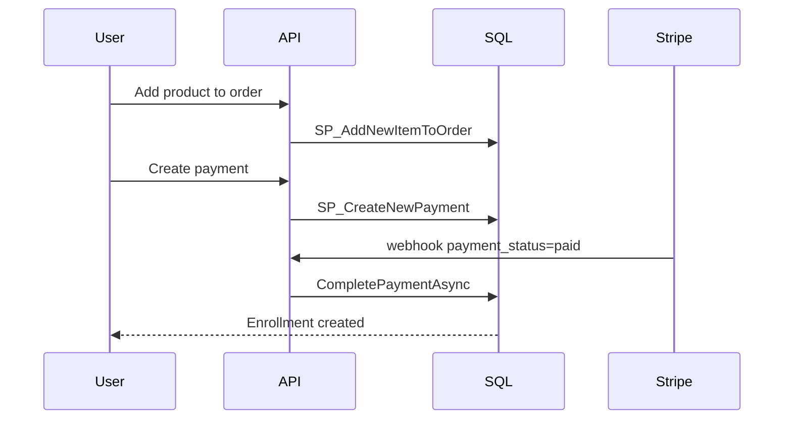

# End-to-End Business Workflows

Navigation: [Overview](00-overview.md) · [Architecture](01-architecture.md) · [Database](02-database.md) · [Business Logic](03-business-logic.md) · [API](05-api-reference.md) · [Security](06-security.md) · [Testing](07-testing-and-deployment.md) · [Glossary](08-glossary.md)

## Purchase flow (individual course)



## Stripe webhook processing

1. Verify HMAC signature.
2. Parse event.
3. If checkout.session.completed/async_payment_succeeded: require payment_status="paid"; extract payment id; if payment pending, complete.
4. Terminal states: expire/fail payment.

## Bundle purchase

Same as individual but enrollment created for bundle product; access to included courses via bundle enrollment (IsUserEnrolled bundle branch).

## Progress update

Client updates lesson progress → UpsertProgress → one row per (user, lesson).

## Certificate retrieval

Issued after completion; retrieved via certificates endpoints.

## Order item mutations

Add/remove items only on Pending/Empty orders; blocked if pending payment.

## Concurrency/idempotency

- Payments idempotent by key.
- Discount usage locked by discount row.
- Progress upsert locked by PK.
- Payment completion locks order first.
```